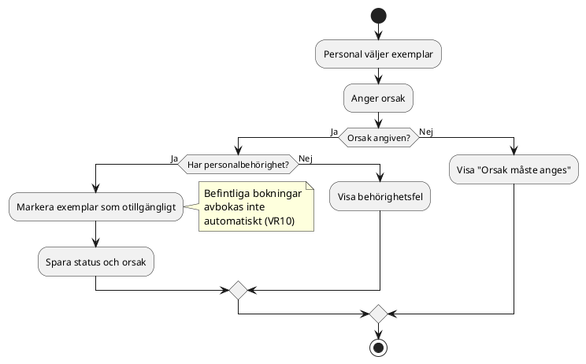
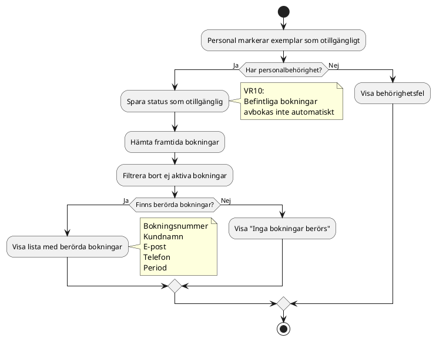
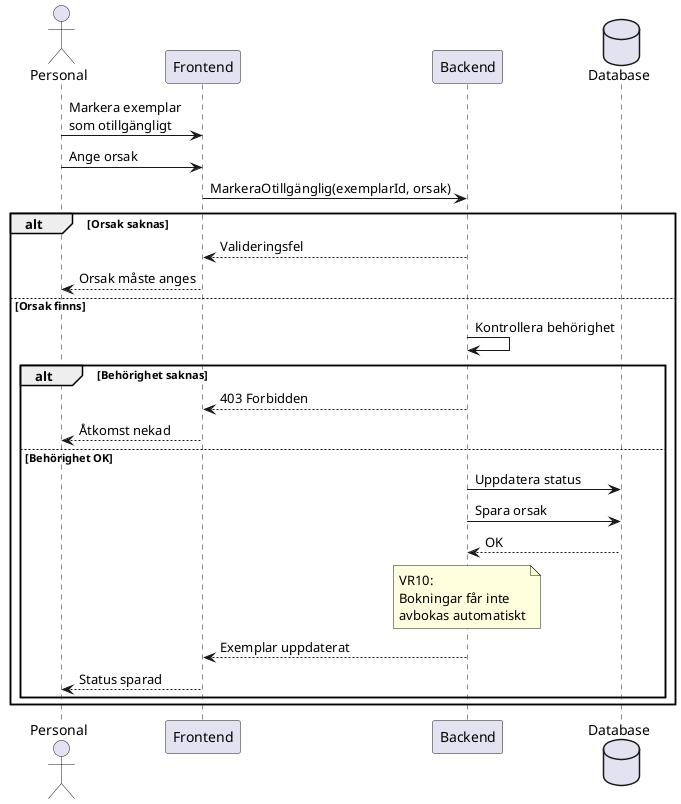
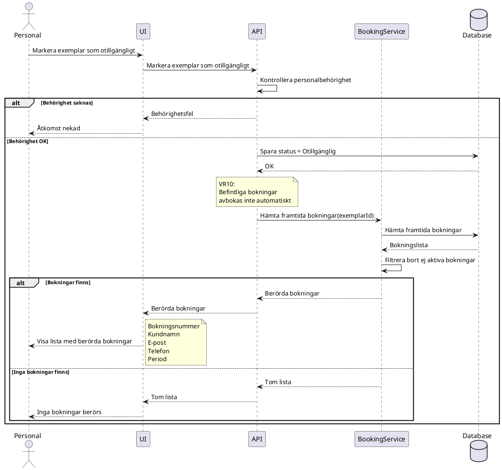

## Anton Carlfors Wennbom - Itteration 1

### Sekvensdiagram v1  
F-15 - Utrustning - Visa berörda bokningar  
US-25 - Som personal vill jag se vilka framtida bokningar som berörs så att jag kan agera i tid.

### Aktivitetsdiagram 24

### Aktivitetsdiagram 24-25

### Sekvensdiagram SD-24

### Sekvensdiagram SD-24-25

### Insikter

Det finns en task med att kolla berhörigheten men inte i AC för denna User Story. Men det bör kanske läggas till

### AC5

Given att användaren inte har personalbehörighet  
When användaren försöker visa berörda bokningar  
Then ska åtkomst nekas

---

### Samt i: US-24 - Som personal vill jag markera ett exemplar som otillgängligt så att ingen bokar trasig utrustning.
### AC

Given att användaren inte har personalbehörighet  
When användaren försöker markera ett exemplar som otillgängligt  
Then ska åtgärden nekas

---
## Egna beslut om förändringar i itteration 1

Ändring i Task 118 från: **Backend - Hämta framtida bokningar för exemplar**  
till: **Backend - Hämta alla bokningar där Bokningens slutdatum >= dagens datum**

När jag skulle börja med implementationen av US-25 så tänkte jag att det kanske är lättre att även ta med US-24 

---
### Att göra för implementation:
* 

---

## Diskussionsunderlag för möte inför itteration 2

En sak jag hade justerat i User Storyn  
Jag ser en liten inkonsekvens:  
Task 118 säger: första dagen är idag eller senare

medan AC1 säger: alla framtida aktiva bokningar

Skulle man istället kunna ändra till:

Bokningens startdatum >= dagens datum

eller

Bokningens slutdatum >= dagens datum

Det blir påverkan på implementationen

---