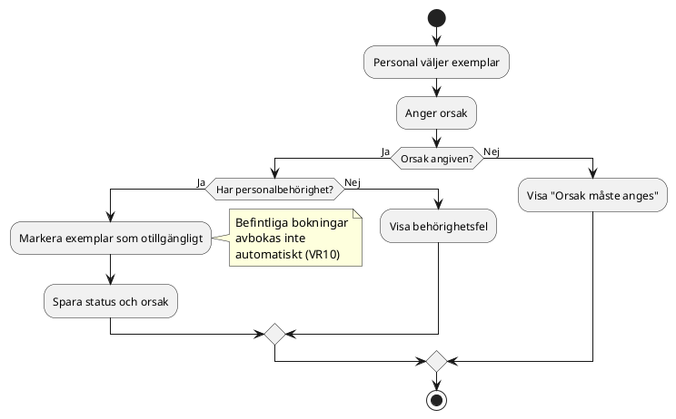
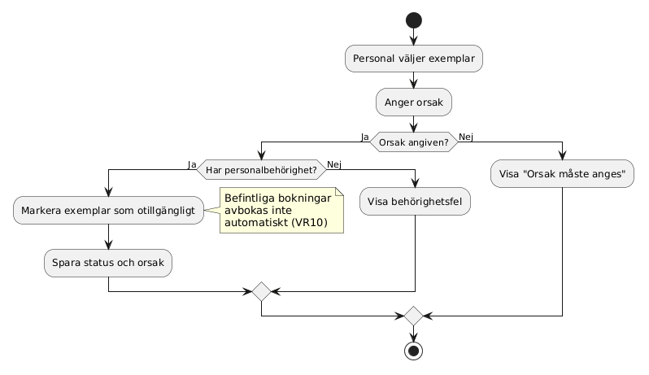
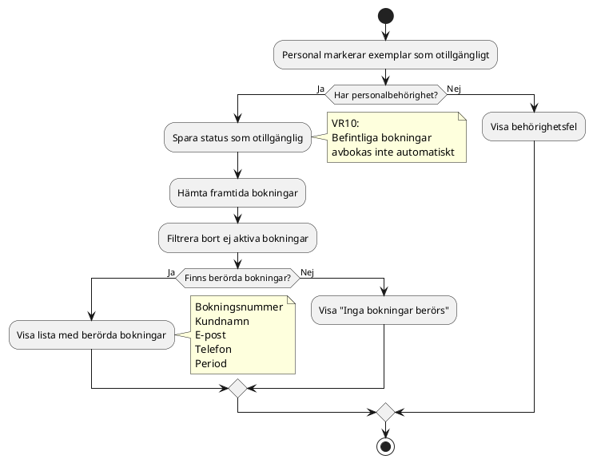
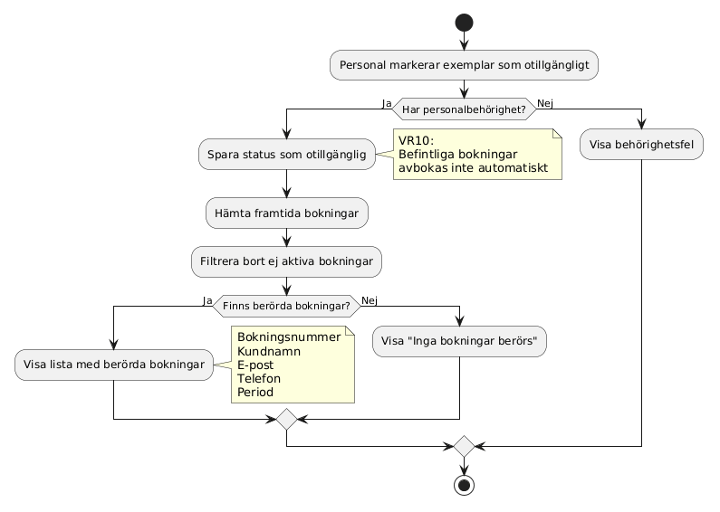
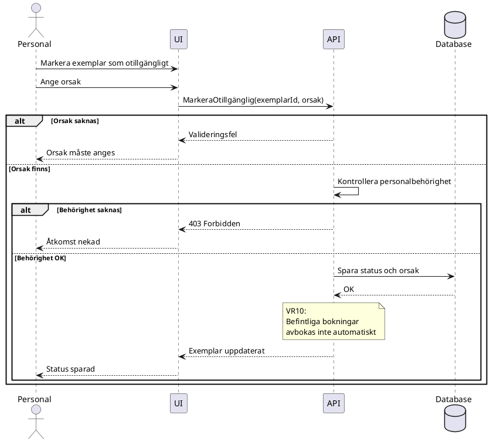
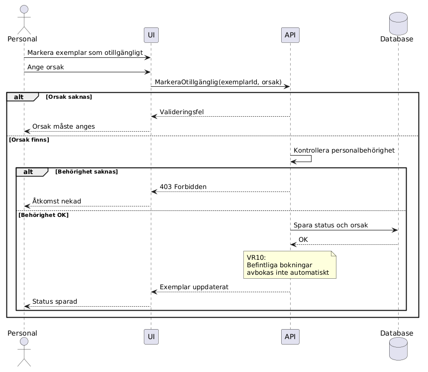
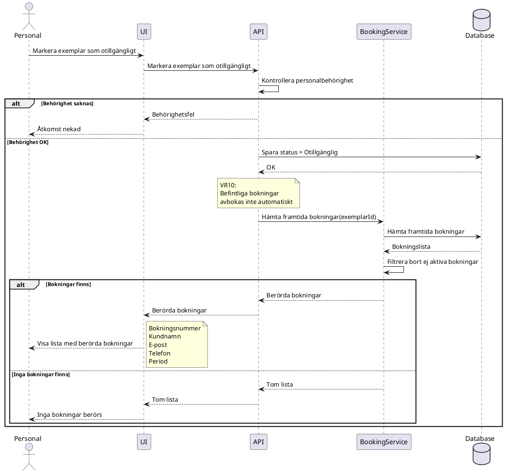
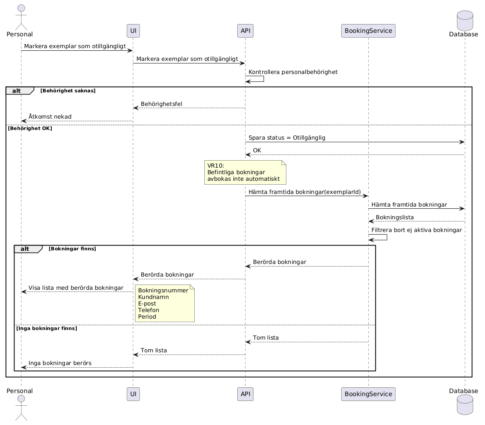

## Anton Carlfors Wennbom - Itteration 1

### Sekvensdiagram v1  
F-15 - Utrustning - Visa berörda bokningar  
US-25 - Som personal vill jag se vilka framtida bokningar som berörs så att jag kan agera i tid.

### Aktivitetsdiagram 24

### Aktivitetsdiagram 24-25

### Sekvensdiagram SD-24

### Sekvensdiagram SD-24-25

### Insikter

Det finns en task med att kolla berhörigheten men inte i AC för denna User Story. Men det bör kanske läggas till

### AC5

Given att användaren inte har personalbehörighet  
When användaren försöker visa berörda bokningar  
Then ska åtkomst nekas

---

### Samt i: US-24 - Som personal vill jag markera ett exemplar som otillgängligt så att ingen bokar trasig utrustning.
### AC

Given att användaren inte har personalbehörighet  
When användaren försöker markera ett exemplar som otillgängligt  
Then ska åtgärden nekas

---
## Egna beslut om förändringar i itteration 1

Ändring i Task 118 från: **Backend - Hämta framtida bokningar för exemplar**  
till: **Backend - Hämta alla bokningar där Bokningens slutdatum >= dagens datum**

När jag skulle börja med implementationen av US-25 så tänkte jag att det kanske är lättre att även ta med US-24 

---
### Att göra för implementation S-24:
* Skapa enum ToolType example. (Drill, Digger, Jigsaw, Sander)
* Skapa enum ExemplarStatus (Available, Unavailable)
* Skapa modell för Utrustning (guid Id, string name, string, Description, ToolType toolType)
* Skapa modell för Exemplar (guid id, guid UtrustningsId, ExemplarStatus Status, string? UnavailableReason) 
* Skapa enum Role (customer, employee, admin)
* Skapa modell för Inloggad (guid Id, string Kundnamn, string Email, string Phone, Role role)
* Skapa enum BookingStatus (Confirmed, Cancelled, Completed)
* Skapa modell för BookingPeriod (DateOnly start, DateOnly end)
* Skapa modell för bokning (guid Id, Exemplar exemplar, guid KundId, BookingStatus Status, BookingPeriod bookinngPeriod)
* Skapa Record UnavailableRequest för att markera utrustning otillgänglig (guid id, string reason)
* Validera att Request är korrekt ifylld
* Komponent för att visa felmeddelanden
* Visa bekräftelse när exemplar markerats som otillgängligt
* Validering av behörighet för att ändra
* Spara status och orsak för exemplar

---
### Att göra för implementation S-25:
* Hämta bokningar för (guid exemplarId)
* Skapa BookingService
* Filtrera till endast aktiva bokningar sluttid >= idag
* Lista alla berörda bokningar (guid Id, string CustomerName, string CustomerEmail, string CustomerPhone, BookingPeriod bookingPeriod)
* Visa "Inga bokningar berörs" när listan är tom
---

## Diskussionsunderlag för möte inför itteration 2

En sak jag hade justerat i User Storyn  
Jag ser en liten inkonsekvens:  
Task 118 säger: första dagen är idag eller senare

medan AC1 säger: alla framtida aktiva bokningar

Skulle man istället kunna ändra till:

Bokningens startdatum >= dagens datum

eller

Bokningens slutdatum >= dagens datum

Det blir påverkan på implementationen

---